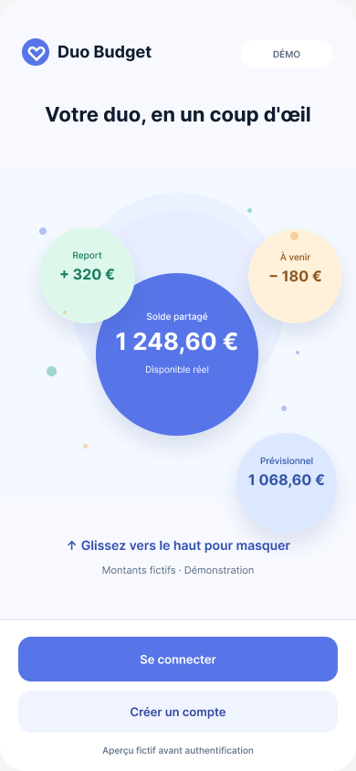
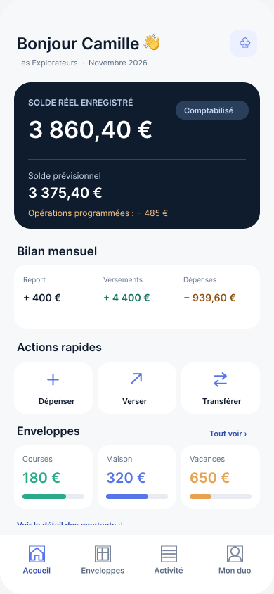
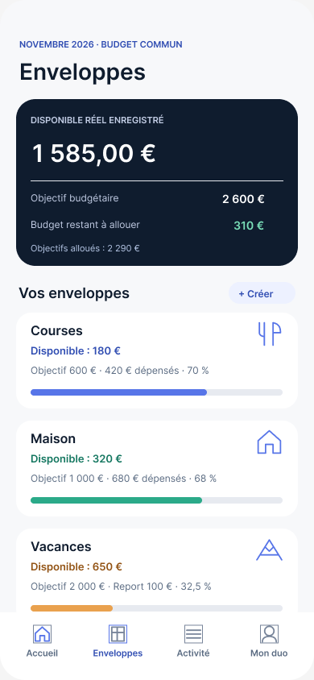
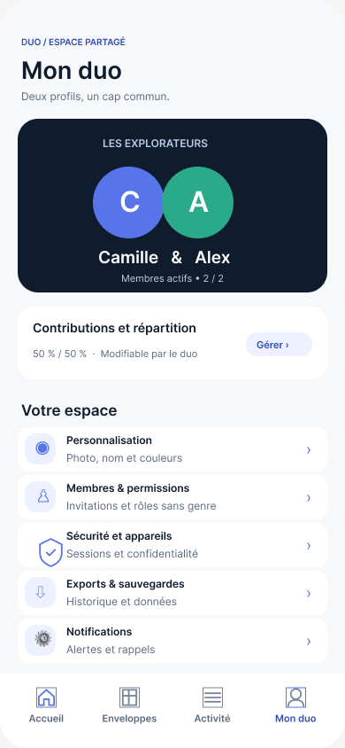

  

  <h3>Le budget à deux, en toute simplicité.</h3>

  
Une application mobile de gestion du budget partagé : enveloppes, dépenses, versements, prévisions et projets à construire ensemble.

  

    <a href="https://www.figma.com/design/ejg17Px9X7tsMsTAvVwwiT/">🎨 Figma V3.0.7</a> ·
    <a href="https://github.com/Steve-Landry-NONO/S-S-Budget/pull/3">🛠️ PR #3 — Duo Glance</a> ·
    <a href="docs/ROADMAP_DUO_BUDGET_2026_2027.md">🗓️ Roadmap</a>
  

---

> [!IMPORTANT]
> **Duo Budget est en développement.** La maquette Figma **V3.0.7 Premium Duo Alive** est notre référence graphique gelée, **pas une application terminée**. La branche \`main\` conserve l'application historique fonctionnelle S&S Budget V2 et comprend désormais le kit de marque (#1) et les premières fondations UI (#2). **Duo Glance est codé dans la PR #3, encore en brouillon et non fusionnée.** Les images ci-dessous sont des **captures de Figma**, et non des captures de l'application compilée. Ne pas saisir de véritables informations financières dans une démo publique.

## Aperçu de l'expérience Duo Budget

<table>
  <tr><th>Duo Glance — accueil</th><th>Accueil — synthèse</th><th>Enveloppes — organisation</th><th>Mon duo — espace partagé</th></tr>
  <tr>
    <td align="center"></td>
    <td align="center"></td>
    <td align="center"></td>
    <td align="center"></td>
  </tr>
</table>

*Visuels exportés du fichier Figma validé V3.0.7. Captures de référence, potentiellement différentes des builds mobiles à venir. Les montants affichés sont des données fictives de présentation.*

**Direction visuelle :** bleu nuit \`#0F1C2E\`, bleu signature \`#5775E8\`, vert positif \`#2BAA89\`, ambre \`#E9A14E\`, fond \`#F7F8FA\`. Le **nuage + cœur** est notre marque officielle. Typographie et contrastes suivent les règles définies dans Figma V3.0.7.

- [Design system et écrans Figma](https://www.figma.com/design/ejg17Px9X7tsMsTAvVwwiT/)
- [Motion Lab — 11 concepts expérimentaux](https://www.figma.com/design/ejg17Px9X7tsMsTAvVwwiT/?node-id=111-62) — **non intégrés aux écrans définitifs**
- [Responsive QA](https://www.figma.com/design/ejg17Px9X7tsMsTAvVwwiT/?node-id=146-62) — variantes 360 / 390 / 430 px

## État réel du développement

| Partie | Statut vérifiable | Suite |
| --- | --- | --- |
| Application historique V2 (Expo + API personnelle) | **Présente sur \`main\`** : fonctionnalités de budget et authentification PIN | Préserver et couvrir par des tests avant migration |
| Identité Duo Budget, logo et ressources SVG | **PR #1 fusionnée** dans \`main\` | Exporter les assets natifs PNG et vérifier leur rendu sur appareil |
| Tokens Premium Duo, \`BalanceCard\`, \`PremiumButton\` | **PR #2 fusionnée** dans \`main\` | Intégrer aux écrans à partir de données métier réelles |
| Duo Glance pré-authentification | **PR #3 en brouillon**, non fusionnée | Recette iOS/Android, PIN et accessibilité |
| CI — garde-fous, Babel JSX et export Expo Web | **Validée par GitHub Actions sur PR #3** | Étendre aux tests unitaires, natifs et de régression |
| Navigation finale et nouveaux écrans | **À développer** | 4 onglets Accueil / Enveloppes / Activité / Mon duo |
| Animations Motion Lab | **Maquettes seulement** | Implémentation progressive après validation mobile |
| Compte multi-duo grand public | **Non livré** | Architecture, isolation des données, authentification et sécurité à concevoir |

L'historique du dépôt et certains noms de paquets conservent **S&S Budget** par souci de compatibilité. L'identité produit cible est **Duo Budget**. La version technique de \`app.json\` ne représente pas à elle seule la maturité de l'interface V3.

### Fonctionnalités présentes dans l'héritage V2

- Gestion des membres, rôles fonctionnels et connexion PIN.
- Enveloppes (« caisses » historiques), budgets, versements et dépenses.
- Dépenses / versements prévus, historiques et suivi des membres.
- Soldes **réels** distincts des **prévisionnels**, reports mensuels par enveloppe.
- Journal d'activité, modifications récentes contrôlées et exports/sauvegardes côté serveur selon les droits.
- Synchronisation privée via API Node.js/Express + SQLite, accessible sur réseau local / Tailscale.

**Règle financière incontournable :** le solde réel ne doit jamais être calculé depuis un objectif budgétaire ; une opération future ne doit pas influencer les montants réalisés. Les calculs V2 restent la référence jusqu'à extraction de sélecteurs testés.

## Architecture actuelle

\`\`\`text
  Mobile Expo / React Native (SDK 54)
  ├── App.js                        Application historique V2
  ├── src/theme/tokens.js           Tokens Premium Duo ✅
  ├── src/components/              BalanceCard, PremiumButton ✅
  └── src/features/glance/          Duo Glance (PR #3 uniquement)
                  |
                  | Session PIN / API privée
                  v
  Node.js / Express ─── SQLite locale
       Serveur personnel (LAN / Tailscale)
\`\`\`

**Pas de connexion bancaire ni de service bancaire réglementé** : Duo Budget est un outil d'organisation budgétaire. L'infrastructure de la bêta grand public devra prendre en charge de nombreux duos isolés les uns des autres ; l'architecture SQLite auto-hébergée n'est **pas** encore cette infrastructure.

### Repères du dépôt

| Chemin | Usage |
| --- | --- |
| \`App.js\` | Interface V2 et connexion aux fonctionnalités existantes |
| \`src/theme/tokens.js\` | Couleurs et styles sémantiques |
| \`src/components/\` | Composants UI préparatoires |
| \`src/features/glance/\` | Premier écran V3, présent sur la branche PR #3 |
| \`brand/svg/\` | Sources officielles du logo, des icônes et du splash |
| \`server/\` | API privée, données et migrations SQLite |
| \`docs/ROADMAP_DUO_BUDGET_2026_2027.md\` | Planning et critères de réception |
| \`docs/V3_0_7_DEV_LOT_01.md\` | Recette détaillée du premier lot |
| \`.github/workflows/duo-budget-ci.yml\` | CI introduite avec la PR #3 |

## Démarrer en développement

Prérequis : **Node.js** et **npm**, Git, téléphone Android/iOS avec Expo Go compatible ou simulateur. L'application actuelle utilise **Expo SDK 54**. Le serveur n'est pas nécessaire pour voir la démonstration fictive de Duo Glance, mais il l'est pour se connecter et retrouver les opérations réelles de la V2.

\`\`\`bash
git clone https://github.com/Steve-Landry-NONO/S-S-Budget.git
cd S-S-Budget

# Branch du premier écran V3 (non fusionnée dans main)
git switch feature/duo-budget-v3-glance-first-screen

npm install
node scripts/check-glance.js
npx expo start -c
\`\`\`

Scanne le QR code avec Expo Go si la version installée est compatible. Sinon, utiliser un simulateur ou préparer un **build EAS Preview** ; l'APK Android sera traité dans un lot ultérieur, il n'est **pas encore distribué**.

Pour un premier contrôle web :

\`\`\`bash
npx expo export --platform web --output-dir dist
\`\`\`

Pour les vérifications de dépendances :

\`\`\`bash
npx expo-doctor
\`\`\`

La CI GitHub sur la PR #3 vérifie la confidentialité statique de Duo Glance, la transformation Babel de l'interface et l'export web Expo. **Elle ne remplace pas** les tests de connexion PIN ni les essais sur appareil Android/iOS.

### Serveur historique, mode privé

\`\`\`bash
cd server
cp .env.example .env
npm install
npm run init-db
npm run dev
\`\`\`

Tester en local : \`curl http://localhost:3001/api/health\`. Les téléphones doivent pouvoir joindre l'API sur le même réseau privé ou via Tailscale. **Ne pas exposer sans audit le port serveur sur Internet** ; protéger \`server/.env\`, la base SQLite et toutes les sauvegardes. Toute migration de données doit être sauvegardée et testée avant déploiement.

## Plan de développement — sprints de deux semaines

| Sprint | Fenêtre indicative | Objectif | Livrable / garde-fou |
| --- | --- | --- | --- |
| **S0 — Fondations** | 5–11 nov. 2026 | GitHub, CI, Duo Glance, alignement des branches | PR #3 testée sur appareils, PIN préservé |
| **S1 — Navigation** | 12–25 nov. | 4 onglets, thème, safe areas | Parcours accessibles sur 360 / 390 / 430 px |
| **S2 — Dashboard** | 26 nov.–9 déc. | Soldes réalisés/prévisionnels, report, activité rapide | Parité chiffrée avec V2 |
| **S3 — Enveloppes** | 10–23 déc. | Liste, détail, dépense, versement | Rôles et calculs vérifiés |
| **S4 — Opérations** | 24 déc.–6 janv. 2027 | Transferts, opérations prévues, historique | Scénarios d'intégrité et confirmations |
| **S5 — Mon duo** | 7–20 janv. | Profil, invitations pilotes, permissions | Sessions et droits côté API |
| **S6 — Motion & a11y** | 21 janv.–3 fév. | Gestes retenus, reduced motion, VoiceOver/TalkBack | Pas de régression UX |
| **S7 — Bêta privée** | 4–17 fév. | EAS preview, tests et corrections P0/P1 | Recette sur plusieurs téléphones |
| **S8+ — Bêta publique** | Dès fin fév., cible modulable | Auth/cloud multi-duo, sécurité, monitoring, stores | Audit et validations avant diffusion |

Ces échéances sont **indicatives**. Le rythme sera ajusté selon la qualité des builds, les validations et les éventuelles contraintes des stores. La bêta publique peut s'étendre jusqu'au printemps 2027.

➡️ [Feuille de route détaillée et règles de validation](docs/ROADMAP_DUO_BUDGET_2026_2027.md)

## Méthode de pilotage

- **Design Freeze :** aucun changement du fichier Figma V3.0.7 sans décision explicite.
- **Une tâche → une branche → une PR :** pas de fusion directe sur \`main\`.
- **Définition de terminé :** code, preuve de test, capture ou build quand pertinent, contrôle sécurité, puis validation.
- **Livraison quotidienne :** le suivi programmé consulte le dépôt et rapporte les changements réels, blocages, tests et décisions requises ; il ne doit jamais annoncer du code inexistant.
- **Revue à chaque sprint :** démo mobile, traitement des anomalies bloquantes et décision go/no-go.
- **Données sensibles :** aucune donnée financière de production dans Figma, les tests publics ou les captures ; toutes les démos publiques sont fictives.
- **CI :** obligatoire avant une fusion touchant la logique d'application ; les tests sur Android et iOS restent distincts de l'export web.

## Tests et livraison Android (en préparation)

> **APK interne : configuration EAS Preview préparée dans la branche Android, mais aucune APK compilée ou publiée pour l'instant.** L'identité Android Preview `com.ss.budgetcouple.preview` évite de remplacer l'application historique.

**Procédure détaillée :** [Build Android Preview / APK](docs/ANDROID_PREVIEW_BUILD.md).

**Étape suivante après ce README :** préparer une version Duo Budget installable sur Android **via EAS Build (APK de test)**, sans renoncer à **Expo Go** pour les boucles rapides. Les deux modes répondent à des besoins différents :

- **Expo Go :** développement et vérification rapide depuis le QR code, avec des limites pour certains modules natifs.
- **APK Preview :** installation autonome, tests de gestes et de navigation, recueil de feedback sur appareil.
- **iOS :** distribution de test à organiser séparément (TestFlight / signature Apple).
- **Avant diffusion :** valider le SDK, les identifiants Android, le contenu des assets, les secrets EAS, le PIN et le comportement hors-ligne.

**La configuration `eas.json` et les contrôles Android sont prêts sur la branche Preview.** Le build reste à lancer depuis un compte Expo connecté ; aucun APK ni lien de téléchargement n'existe encore.

## Historique et suivi

- **V2 (S&S Budget)** : application historique self-hosted avec budgets, prévisions, reports, journal et PIN ; le dernier commit de \`main\` avant la migration V3 était « Version 2.8 — Authentification par PIN et verrouillage des profils ».
- **V3.0.7 (Figma)** : design et responsive gelés, Motion Lab séparé.
- **PR #1** : kit de marque vectoriel — fusionné dans \`main\`.
- **PR #2** : tokens et composants UI — fusionnés dans \`main\`.
- **PR #3** : Duo Glance, entrée de connexion et CI — **en brouillon** ; vérifications web en CI réussies, recette mobile restant à faire.

[Comparer les pull requests](https://github.com/Steve-Landry-NONO/S-S-Budget/pulls) · [Consulter la PR #3](https://github.com/Steve-Landry-NONO/S-S-Budget/pull/3)

---

  Duo Budget · Premium Duo Alive · Développé progressivement avec validation produit et contrôle qualité.

